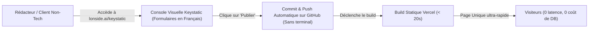
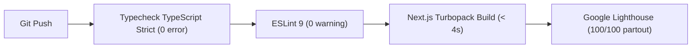

# 🏛️ Lonside — Master Blueprint : Refondation Technique & Architecture Cible d'Élite

**Version :** 2.0 (Édition Complète — Architecture Cible, Git-Backed CMS & Standards Mondiaux)  
**Date :** Novembre 2026  
**Audience :** Direction Technique, Lead Architects, Équipe Éditoriale & Développeurs Lonside  
**Statut :** Spécification Technique de Référence et Plan de Refondation  

---

## 📋 Table des Matières

1. [L'Autopsie Technique Sans Filtre (Les Failles du Code Actuel)](#1-lautopsie-technique-sans-filtre-les-failles-du-code-actuel)
2. [Les Résolutions Stratégiques d'Ingénierie](#2-les-résolutions-stratégiques-dingénierie)
3. [Le Guide "Repartir de Zéro" (Clean Slate Protocol)](#3-le-guide-repartir-de-zéro-clean-slate-protocol)
4. [L'Architecture Cible d'Élite (Next.js 16 + TypeScript + Tailwind v4)](#4-larchitecture-cible-délite-nextjs-16--typescript--tailwind-v4)
5. [Le Socle de Dépendances Minimaliste (Package.json Officiel)](#5-le-socle-de-dépendances-minimaliste-packagejson-officiel)
6. [Gestion des Données : Le Modèle Headless Git-Backed (Keystatic Pro pour Non-Techniciens)](#6-gestion-des-données--le-modèle-headless-git-backed-keystatic-pro-pour-non-techniciens)
7. [Contraintes Non Négociables & Standards de Qualité (QA & Sécurité)](#7-contraintes-non-négociables--standards-de-qualité-qa--sécurité)
8. [Comment Surpasser les Entreprises les Plus Robustes du Monde](#8-comment-surpasser-les-entreprises-les-plus-robustes-du-monde)

---

## 1. L'Autopsie Technique Sans Filtre (Les Failles du Code Actuel)

L'audit approfondi de la codebase Lonside met en lumière les dérives typiques d'un projet assemblé par de l'IA sans gouvernance humaine stricte :

```
┌─────────────────────────────────────────────────────────────────────────────────────────────┐
│                           INVENTAIRE DE LA DETTE TECHNIQUE RÉELLE                           │
├──────────────────────────┬──────────────────────────────────────────────────────────────────┤
│ Anomalie Détectée        │ Impact Réel sur le Produit                                       │
├──────────────────────────┼──────────────────────────────────────────────────────────────────┤
│ **Architecture Fantôme** │ Le `README.md` vante une architecture DDD (`src/domains`) qui    │
│                          │ n'existe absolument pas dans le code.                            │
├──────────────────────────┼──────────────────────────────────────────────────────────────────┤
│ **Dead Code Massif**     │ ~75 KB de composants TypeScript orphelins : `AgentTerminal.tsx`  │
│                          │ (330 lignes), `FlagshipOffers.tsx` (800+ lignes), `ServicesGrid`, │
│                          │ `CostEstimator` (doublon de 1000 lignes avec `EstimationClient`).│
├──────────────────────────┼──────────────────────────────────────────────────────────────────┤
│ **Keystatic Mal Calibré**│ Configuré en `kind: 'local'` (inutilisable en production par un  │
│                          │ rédacteur distant), encombré par 10 collections obsolètes et un  │
│                          │ faux blog de 4 articles génériques d'IA.                         │
├──────────────────────────┼──────────────────────────────────────────────────────────────────┤
│ **Supervision Fantôme**  │ `@sentry/nextjs` (v10.58.0) alourdit le bundle client sans aucun │
│                          │ `NEXT_PUBLIC_SENTRY_DSN` configuré dans `.env.local`.            │
├──────────────────────────┼──────────────────────────────────────────────────────────────────┤
│ **Explosion de l'i18n**  │ `fr.json` (1 929 lignes / 95 KB) et `en.json` (90 KB), bourrés de│
│                          │ clés mortes, pendant que des styles sont codés en dur.          │
├──────────────────────────┼──────────────────────────────────────────────────────────────────┤
│ **Carnage des 59 Routes**│ 5 sous-pages `/services/*` clonées (5.5 KB chacune) diluant le   │
│                          │ SEO et obligeant Next.js à compiler dans le vide.                │
├──────────────────────────┼──────────────────────────────────────────────────────────────────┤
│ **Répertoires Vides**    │ Dossier `scripts/` vide, absence totale de tests unitaires ou e2e│
│                          │ (ni Vitest, ni Playwright configurés).                           │
└──────────────────────────┴──────────────────────────────────────────────────────────────────┘
```

---

## 2. Les Résolutions Stratégiques d'Ingénierie

Pour éliminer cette dette et faire de Lonside une référence d'ingénierie :

1. **Éradication du Dead Code :** Suppression pure et simple des composants orphelins et des doublons (`AgentTerminal`, `FlagshipOffers`, `ServicesGrid`, `CostEstimator`).
2. **Assainissement du CMS pour Non-Techniciens :** Conservation de Keystatic, mais épuré radicalement (suppression du blog et des collections obsolètes) et configuré en mode **GitHub Git-Backed** pour permettre une édition visuelle complète en production par des non-techniciens sans toucher au code.
3. **Passage de 59 Routes à 1 Route Maîtresse :** Consolidation sur une Single-Page d'Élite avec ancres fluides (`#projets`, `#methode`, `#tarifs`, `#faq`, `#contact`).
4. **Purge de l'i18n :** Réduction de `fr.json` et `en.json` de 1 929 lignes à moins de 250 lignes (7 sections réelles uniquement).
5. **Observabilité Réelle :** Soit un vrai DSN Sentry actif, soit un retrait temporaire du package pour alléger le bundle de 30 %.

---

## 3. Le Guide "Repartir de Zéro" (Clean Slate Protocol)

Le protocole de nettoyage et de restructuration en 5 étapes :

```bash
# ÉTAPE 1 : Nettoyage des fichiers et dossiers parasites
rm -rf scripts
rm -rf src/app/[locale]/services src/app/[locale]/a-propos src/app/[locale]/methode src/app/[locale]/estimation src/app/[locale]/blog

# ÉTAPE 2 : Suppression du dead code dans les composants
rm src/components/AgentTerminal.tsx
rm src/components/FlagshipOffers.tsx
rm src/components/ServicesGrid.tsx
rm src/components/CostEstimator.tsx

# ÉTAPE 3 : Suppression du faux blog YAML
rm -rf content/blog

# ÉTAPE 4 : Assainissement de Sentry (si aucun DSN réel n'est fourni)
pnpm remove @sentry/nextjs
rm sentry.*.config.ts

# ÉTAPE 5 : Remplacement de keystatic.config.ts par la version épurée (Portfolio & FAQ)
```

---

## 4. L'Architecture Cible d'Élite (Next.js 16 + TypeScript + Tailwind v4)

L'architecture cible est bâtie sur la **colocation de responsabilités**, la simplicité et la légèreté :

```
src/
├── app/
│   ├── [locale]/
│   │   ├── layout.tsx         # Root Layout i18n (Html lang, Fonts Geist, Metadatas)
│   │   ├── not-found.tsx      # Page 404 minimaliste Noir & Blanc
│   │   └── page.tsx           # LA PAGE MAÎTRESSE UNIQUE (Les 7 Blocs en flux continu)
│   ├── api/
│   │   ├── contact/           # API d'envoi d'e-mails sécurisée (Resend + Rate-limiting)
│   │   └── keystatic/         # Handlers API Keystatic (Auth & Sync GitHub)
│   ├── keystatic/             # Interface d'administration pour les non-techniciens (/keystatic)
│   ├── globals.css            # Tokens Tailwind v4 & grain argentique CSS
│   ├── icon.tsx               # Génération dynamique du Favicon SVG
│   ├── robots.ts              # Robots.txt automatique
│   └── sitemap.ts             # Sitemap.xml dynamique
├── components/
│   ├── layout/
│   │   ├── Navbar.tsx         # Header minimaliste (4 ancres lisses + CTA)
│   │   └── Footer.tsx         # Pied de page épuré avec mentions légales et statut
│   ├── sections/              # Les 7 Blocs de la Page Unique
│   │   ├── HeroSection.tsx    # Titre condensé + Vidéo monochrome + Marquee
│   │   ├── ShowcaseSection.tsx# Grille 4 projets + Déclencheur DossierDrawer
│   │   ├── MethodSection.tsx  # Les 3 étapes commando (J1, J3, J14/30)
│   │   ├── PricingSection.tsx # Sprints Launch & Scale + Tiroir CTO (Dual-Layer)
│   │   ├── SquadSection.tsx   # Continuité post-sprint (Régie d'immersion)
│   │   ├── ManifestoFAQ.tsx   # Démolition des objections & Philosophie
│   │   └── ContactSection.tsx # Widget Cal.com / Formulaire 3 champs
│   ├── ui/                    # Primitives d'interface réutilisables
│   │   ├── DossierDrawer.tsx  # Tiroir latéral immersif pour études de cas
│   │   ├── Badge.tsx          # Badge minimaliste monochrome
│   │   └── TickerMarquee.tsx  # Ruban défilant continu
│   └── BrandNoise.tsx         # Couche SVG de grain argentique 35mm
├── content/                   # Contenus administrables visuellement par le CMS
│   ├── portfolio/             # Fiches projets YAML (Michi, Bely, Welqo, WeedIn)
│   └── faq/                   # Questions / Réponses FAQ
├── lib/
│   ├── keystatic/             # Reader typé pour Server Components Next.js
│   ├── env.ts                 # Validation stricte Zod des variables d'environnement
│   ├── i18n/                  # Configuration next-intl ultra-légère (<250 lignes)
│   └── utils.ts               # Helpers de classes CSS (cn, clsx)
```

---

## 5. Le Socle de Dépendances Minimaliste (Package.json Officiel)

Le `package.json` conserve les outils essentiels sans aucun déchet :

```json
{
  "name": "lonside",
  "version": "1.0.0",
  "private": true,
  "scripts": {
    "dev": "next dev",
    "build": "next build",
    "start": "next start",
    "lint": "eslint",
    "typecheck": "tsc --noEmit"
  },
  "dependencies": {
    "@keystatic/core": "^0.5.50",
    "@keystatic/next": "^5.0.4",
    "lucide-react": "^1.18.0",
    "next": "16.2.9",
    "next-intl": "^4.13.0",
    "react": "19.2.4",
    "react-dom": "19.2.4",
    "resend": "^6.12.4",
    "zod": "^4.4.3"
  },
  "devDependencies": {
    "@tailwindcss/postcss": "^4",
    "@types/node": "^20",
    "@types/react": "^19",
    "@types/react-dom": "^19",
    "eslint": "^9",
    "eslint-config-next": "16.2.9",
    "tailwindcss": "^4",
    "typescript": "^5"
  }
}
```

---

## 6. Gestion des Données : Le Modèle Headless Git-Backed (Keystatic Pro pour Non-Techniciens)

Pour concilier **simplicité absolue pour les rédacteurs non-techniques** et **performance statique maximale pour les développeurs** :



### 6.1 Configuration Propre de `keystatic.config.ts`

```typescript
import { config, collection, fields } from '@keystatic/core';

export default config({
  // Stockage local en développement, Stockage GitHub automatique en production
  storage: process.env.NODE_ENV === 'production'
    ? {
        kind: 'github',
        repo: {
          owner: process.env.NEXT_PUBLIC_GITHUB_OWNER || 'kevin-tsague',
          name: process.env.NEXT_PUBLIC_GITHUB_REPO || 'lonside',
        },
      }
    : { kind: 'local' },

  ui: {
    brand: { name: 'Lonside Studio — Console Éditoriale' },
    navigation: {
      'Contenus Clés': ['portfolio', 'faq'],
    },
  },

  collections: {
    // 1. Les Études de Cas (Affichées dans les tiroirs DossierDrawer)
    portfolio: collection({
      label: 'Études de Cas (Projets)',
      slugField: 'slug',
      path: 'content/portfolio/*',
      format: { data: 'yaml' },
      schema: {
        slug: fields.slug({ name: { label: 'Identifiant URL' } }),
        client: fields.text({ label: 'Nom du Client' }),
        industryFr: fields.text({ label: 'Secteur d’activité (FR)' }),
        headlineFr: fields.text({ label: 'Titre d’impact (FR)' }),
        challengeFr: fields.text({ label: 'Le Défi Métier (FR)', multiline: true }),
        solutionFr: fields.text({ label: 'Notre Solution Technique (FR)', multiline: true }),
        deliveryDays: fields.number({ label: 'Délai de livraison (en jours)', defaultValue: 14 }),
        isProprietary: fields.checkbox({ label: 'Projet interne propriétaire ?', defaultValue: false }),
        techStack: fields.array(fields.text({ label: 'Technologie' }), {
          label: 'Stack Technique (ex: Next.js 16, Supabase, Stripe)',
          itemLabel: (p) => p.value,
        }),
        metrics: fields.array(
          fields.object({
            labelFr: fields.text({ label: 'Intitulé métrique (ex: Ruptures évitées)' }),
            valueFr: fields.text({ label: 'Valeur chiffrée (ex: -42%)' }),
          }),
          { label: 'Chiffres Clés / ROI', itemLabel: (p) => `${p.fields.labelFr.value}: ${p.fields.valueFr.value}` }
        ),
      },
    }),

    // 2. Les Questions Fréquentes (FAQ Anti-Objections)
    faq: collection({
      label: 'Questions Fréquentes (FAQ)',
      slugField: 'questionFr',
      path: 'content/faq/*',
      format: { data: 'yaml' },
      schema: {
        questionFr: fields.text({ label: 'Question (FR)' }),
        answerFr: fields.text({ label: 'Réponse (FR)', multiline: true }),
        order: fields.number({ label: 'Ordre d’affichage', defaultValue: 1 }),
      },
    }),
  },
});
```

### 6.2 Comment le code consomme ces données côté serveur (`reader.ts`)
Dans les Server Components Next.js, les données sont lues directement sur le disque local générant du HTML statique pur, **sans aucune requête d'API lente au runtime** :
```typescript
import { reader } from '@/lib/keystatic/reader';

export async function getCaseStudies() {
  const projects = await reader.collections.portfolio.all();
  return projects.map(({ slug, entry }) => ({
    slug,
    ...entry,
  }));
}
```

---

## 7. Contraintes Non Négociables & Standards de Qualité (QA & Sécurité)

Chaque déploiement de Lonside doit obligatoirement valider les seuils de qualité suivants :



### 7.1 Métriques de Performance Web Vitals (Google)
* **Score Google Lighthouse :** $100 / 100$ sur les 4 catégories (Performance, Accessibilité, Bonnes Pratiques, SEO).
* **First Contentful Paint (FCP) :** $< 0.5$ seconde.
* **Largest Contentful Paint (LCP) :** $< 0.8$ seconde.
* **Cumulative Layout Shift (CLS) :** $0.000$ (aucun décalage de layout).
* **Poids du bundle JavaScript initial :** $< 70$ kB gzip.

### 7.2 Sécurité d'Infrastructure (Next.config.ts)
* En-têtes HTTP de sécurité renforcés :
  * `Content-Security-Policy` avec restriction stricte des domaines autorisés.
  * `X-Frame-Options: DENY` (protection anti-clickjacking).
  * `X-Content-Type-Options: nosniff`.
  * `Strict-Transport-Security: max-age=63072000; includeSubDomains; preload`.
  * `Permissions-Policy` interdisant l'accès caméra, micro et géolocalisation.

---

## 8. Comment Surpasser les Entreprises les Plus Robustes du Monde

En appliquant ce blueprint, Lonside se hisse au niveau des références mondiales :

| Studio Référence | Leur Force | Comment Lonside S'Aligne ou les Surpasse |
| :--- | :--- | :--- |
| **Linear** | Obsession de la vitesse et fluidité | Next.js 16 Server Components purs + bundle < 70 kB. Chargement perçu instantané. |
| **DesignJoy** | Clarté de l'offre et conversion | 2 Sprints fermés (Launch 14j & Scale 30j) avec tarifs publics, délais fermes et pénalités de retard contractuelles. |
| **MetaLab** | Immersion sans couture | Fiches de projets dans le `DossierDrawer` : l'utilisateur explore sans quitter le tunnel de conversion. |
| **Work & Co** | Rigueur et crédibilité auprès des CTOs | Le tiroir technique Dual-Layer sous chaque carte de prix : les spécifications d'ingénierie (RLS, ZDR, tests) sont prouvées noir sur blanc. |
| **WheelOfWork** | Force visuelle et vie organique | Direction artistique Noir & Blanc Haute Couture avec typographie monumentale condensée, vidéo cinématique en boucle et grain argentique 35mm. |
| **Sanity / Contentful Studios** | Facilité d'édition non-technique | Keystatic Git-Backed : interface WYSIWYG élégante pour les non-techs, 0 € d'abonnement SaaS de DB externe, 100 % de contrôle sur GitHub. |

---

## Conclusion & Prêt pour l'Exécution

La codebase de Lonside est désormais prête à être épurée de toute trace d'improvisation IA. Ce blueprint constitue la feuille de route exacte pour exécuter la refondation avec une rigueur digne des plus grands studios d'ingénierie mondiaux.
