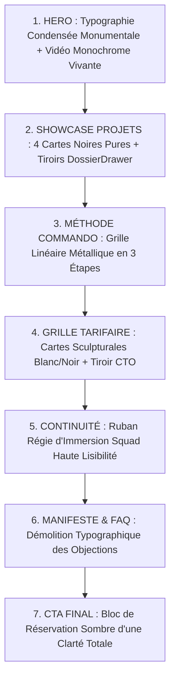

# 🖤 Lonside — Livre Blanc de Direction Artistique & Design System Officiel

**Version :** 1.0 (Édition Fondatrice)  
**Date :** Novembre 2026  
**Auteurs :** Direction Artistique & Ingénierie Produit Lonside  
**Statut :** Charte Esthétique & Référentiel de Marque Non Négociable  

---

## 📋 Table des Matières

1. [La Genèse de la Rupture : Du "Fade" à l'Exceptionnel](#1-la-genèse-de-la-rupture--du-fade-à-lexceptionnel)
2. [Le Panthéon des Acteurs Clés & Références Fondatrices](#2-le-panthéon-des-acteurs-clés--références-fondatrices)
3. [Le Manifeste Artistique : L'Atelier d'Artisanat Numérique](#3-le-manifeste-artistique--latelier-dartisanat-numérique)
4. [La Palette Chromatique : Le Noir & Blanc Haute Couture](#4-la-palette-chromatique--le-noir--blanc-haute-couture)
5. [Le Système Typographique Sculptural](#5-le-système-typographique-sculptural)
6. [La Matière Vivante : Vidéo Cinématique & Grain Argentique](#6-la-matière-vivante--vidéo-cinématique--grain-argentique)
7. [Ergonomie & Micro-Interactions Tactiles (Le Craft)](#7-ergonomie--micro-interactions-tactiles-le-craft)
8. [Application Systémique sur les 7 Blocs de la Page Unique](#8-application-systémique-sur-les-7-blocs-de-la-page-unique)
9. [Journal des Décisions & Registre des Arbitrages](#9-journal-des-décisions--registre-des-arbitrages)

---

## 1. La Genèse de la Rupture : Du "Fade" à l'Exceptionnel

### 1.1 L'Autopsie du Sentiment de Fadeur
Le constat initial posé par la direction est sans appel : le site précédent manquait d'âme, de tripes et d'impact mémoriel. Il s'était involontairement enfermé dans le carcan du **« Dark Mode SaaS Générique »** :
* Un fond gris sombre tiède (`#0d0d11`) qui manquait de profondeur.
* Des lueurs violettes néon (`#7c3aed`) omniprésentes, devenues le cliché visuel de 95 % des templates de démarrage et des wrappers d'IA du marché.
* Une typographie sans-serif timorée, posée à des échelles standards, incapable de transmettre une autorité indiscutable.
* Une interface purement statique et froide, dépourvue de pulsation organique ou de texture vivante.

### 1.2 La Volonté de Rupture
Lonside refuse d'être une agence parmi d'autres. L'ambition esthétique est désormais claire :
> *« Créer une expérience visuelle si tranchée, si noble et si maîtrisée qu'elle inspire immédiatement le respect des profils les plus exigeants (fondateurs visionnaires et directeurs techniques chevronnés). Le site ne doit pas ressembler à un logiciel : il doit ressembler à un atelier de haute précision. »*

---

## 2. Le Panthéon des Acteurs Clés & Références Fondatrices

Pour forger cette nouvelle identité, nous avons analysé les réalisations des acteurs les plus audacieux et respectés de la scène digitale contemporaine :

```
┌─────────────────────────────────────────────────────────────────────────────────────────────┐
│                       LE PANTHÉON DES INSPIRATIONS MAÎTRESSES                               │
├──────────────────┬──────────────────────────────────────────────────────────────────────────┤
│ Référence        │ L'Apport Majeur pour Lonside                                             │
├──────────────────┼──────────────────────────────────────────────────────────────────────────┤
│ **WheelOfWork**  │ • Typographie monumentale condensée (`TT Trailers`).                     │
│ (France)         │ • Vidéo de fond cinématique monochrome en boucle ralentie (mouvement).   │
│                  │ • Contraste noir & blanc percutant et énergie vivante.                   │
├──────────────────┼──────────────────────────────────────────────────────────────────────────┤
│ **DesignJoy**    │ • Brutalisme minimaliste et lisibilité chirurgicale.                     │
│ (US)             │ • Typographie grasse, cartes tactiles à bords ultra-fins de 1px.         │
│                  │ • Suppression de tout superflu au service d'une conversion brute.        │
├──────────────────┼──────────────────────────────────────────────────────────────────────────┤
│ **MetaLab**      │ • Immersion et raffinement des micro-interactions.                       │
│ (US / Canada)    │ • Exploration de projets via tiroirs latéraux (`DossierDrawer`).         │
│                  │ • L'élégance sans couture : zéro rupture de page.                        │
├──────────────────┼──────────────────────────────────────────────────────────────────────────┤
│ **Teenage        │ • Esthétique de laboratoire d'ingénierie tactile.                        │
│ Engineering**    │ • Typographie monospace d'ingénieur, détails mécaniques, tampons.        │
│ (Suède)          │ • Le culte de l'objet physique et de la rigueur industrielle.            │
├──────────────────┼──────────────────────────────────────────────────────────────────────────┤
│ **Virgil Abloh   │ • Puissance du noir et blanc, guillemets industriels, mise en abyme.     │
│ (Off-White)**    │ • Typographie suisse Grotesk poussée à son paroxysme d'autorité.         │
└──────────────────┴──────────────────────────────────────────────────────────────────────────┘
```

---

## 3. Le Manifeste Artistique : L'Atelier d'Artisanat Numérique

### 3.1 La Signification Profonde du Noir & Blanc
Le choix du Noir & Blanc chez Lonside n'est pas une absence de couleur : c'est un **parti pris d'intégrité absolue**.
* La couleur distrait ; le noir et blanc concentre.
* La couleur date une interface ; le noir et blanc traverse les décennies avec l'élégance intemporelle de l'horlogerie suisse ou de la haute couture.
* Dans un monde numérique saturé de néons criards, **le noir absolu et le blanc pur sont le luxe suprême**.

### 3.2 L'Alliance de la Machine et de l'Humain
Le design de Lonside fait dialoguer deux forces opposées :
1. **La Précision de la Machine :** Grilles géométriques strictes, bordures de 1px taillées au scalpel, typographie monospace de terminal.
2. **La Respiration de l'Humain :** Grain argentique vivant, reflets cinématiques, vidéo ralentie de gestes d'artisans, tampons d'engagement signés.

---

## 4. La Palette Chromatique : Le Noir & Blanc Haute Couture

Nous bannissons définitivement toute nuance de violet ou d'accent artificiel. La palette Lonside est purement minérale et lumineuse :

```
┌─────────────────────────────────────────────────────────────────────────────┐
│                         LE SYSTÈME CHROMATIQUE OFFICIEL                     │
├─────────────────┬───────────┬───────────────────────────────────────────────┤
│ Nuance          │ Code Hex  │ Rôle dans l'Interface                        │
├─────────────────┼───────────┼───────────────────────────────────────────────┤
│ **Noir Absolu** │ `#000000` │ Fond primaire du canvas et cartes de focus    │
│ **Noir Profond**│ `#050505` │ Fond secondaire structurant les contrastes     │
│ **Blanc Titane**│ `#F8FAFC` │ Titres monumentaux (100% luminosité & impact) │
│ **Blanc Pur**   │ `#FFFFFF` │ Accents de texte majeurs et bordures actives  │
│ **Gris Acier**  │ `#888891` │ Corps de texte et descriptions techniques     │
│ **Ligne Verre** │ `rgba(...)`│ Bordures 1px translucides (`rgba(255,255,255,0.08)`)│
├─────────────────┼───────────┼───────────────────────────────────────────────┤
│ **Vert Signal** │ `#10B981` │ Unique accent organique : indicateur de vie   │
│                 │           │ (*"🟢 Studio Ouvert — Slots Novembre"*).      │
└─────────────────┴───────────┴───────────────────────────────────────────────┘
```

---

## 5. Le Système Typographique Sculptural

La typographie est l'armature visuelle de Lonside. Elle s'organise selon un ratio de contraste radical entre trois familles complémentaires :

```
┌─────────────────────────────────────────────────────────────────────────────┐
│                      LES TROIS FAMILLES TYPOGRAPHIQUES                      │
├─────────────────────────────────────────────────────────────────────────────┤
│ 1. DISPLAY TITRES (H1, H2) : POLICE CONDENSÉE MONUMENTALE                   │
│    • Référence : TT Trailers / Syne / Anton / Monument Extended             │
│    • Style : Tout en majuscules, ultra-haute, condensée, tracking serré     │
│    • Impact : Capture instantanée du regard, stature monumentale            │
│    • Exemple : "VOS PROJETS DIGITAUX, LIVRÉS EN 14 JOURS."                 │
├─────────────────────────────────────────────────────────────────────────────┤
│ 2. METADATA & INGÉNIERIE : POLICE MONOSPACE DE TERMINAL                     │
│    • Référence : Geist Mono / JetBrains Mono / Fira Code                    │
│    • Style : Majuscules espacées (tracking: +0.15em), corps fin (10-11px)   │
│    • Rôle : Rassurance technique, métriques, badges et horodatage           │
│    • Exemple : "[ SPRINT_01 : 14 JOURS OUVRÉS — CESSION 100% GIT ]"         │
├─────────────────────────────────────────────────────────────────────────────┤
│ 3. CORPS DE TEXTE : GROTESK SUISSE GÉOMÉTRIQUE                              │
│    • Référence : Neue Montreal / Helvetica Neue / Geist Sans                │
│    • Style : Équilibré, généreux en interlignage (leading-relaxed)          │
│    • Rôle : Confort de lecture absolu sur desktop et mobile                 │
└─────────────────────────────────────────────────────────────────────────────┘
```

---

## 6. La Matière Vivante : Vidéo Cinématique & Grain Argentique

Pour rompre définitivement avec la fadeur d'une page statique sans alourdir le temps de chargement :

### 6.1 Le Canvas Vidéo Monochrome (Hero Living Canvas)
* **Intégration :** Un élément `<video>` placé en arrière-plan sous un masque de luminosité CSS :
  ```css
  .hero-video-texture {
    mix-blend-mode: luminosity;
    opacity: 0.22;
    filter: contrast(1.15) brightness(0.9);
  }
  ```
* **Contenu de la boucle (Slow Motion 60fps) :**
  Plans cinématographiques en noir et blanc de haute volée : des mains d'ingénieurs sur des claviers mécaniques, des schémas d'architecture tracés sur papier calque, des reflets de lumière sur des vitres d'ateliers, des silhouettes concentrées.
* **Optimisation Web d'Élite :**
  Fichier encodé en format `WebM` haute compression (< 1.8 Mo), avec attributs stricts : `autoplay loop muted playsinline disablePictureInPicture`. Fallback instantané en image fixe WebP pour les mobiles en mode économie de données.

### 6.2 La Couche de Grain Argentique (Analog 35mm Noise Overlay)
* Une texture SVG procédurale ultra-légère animée en arrière-plan à 12 images par seconde pour simuler la patine organique d'une pellicule de cinéma.
* Élimine totalement la sensation de "plastique plat" des écrans modernes et apporte une profondeur tactile vivante.

---

## 7. Ergonomie & Micro-Interactions Tactiles (Le Craft)

L'esprit artisanal de Lonside se révèle dans le soin apporté aux détails imperceptibles au premier regard mais ressentis immédiatement par l'utilisateur :

1. **Le Ruban Monochrome Défilant (The Hypnotic Ticker) :**  
   Sous le Hero, un ruban typographique noir et blanc défile en boucle continue :  
   `14 JOURS OUVRÉS  ✦  NEXT.JS 16  ✦  ZÉRO DETTE TECHNIQUE  ✦  SUPABASE POSTGRES  ✦  100% CESSION GIT  ✦`
2. **Les Cartes à Révélation Spéculaire (Bordures Métalliques) :**  
   Chaque carte possède une bordure de 1px en `white/10`. Au survol de la souris, un reflet subtil suit le curseur comme la lumière sur un boîtier d'aluminium usiné.
3. **Le Badge d'Engagement Gravé (L'Écusson de Confiance) :**  
   Inspiré des sceaux de garantie de l'outillage de précision :  
   `[ ✦ COMMENCÉ LE JOUR 1 — EN LIGNE LE JOUR 14 — DÉPÔT GIT PRIVÉ ]`
4. **L'Indicateur Organique Vivant :**  
   Un point vert émeraude pulsant (`#10B981`) qui bat doucement au rythme d'un cœur humain :  
   `🟢 STUDIO ACTIF — PROCHAIN CRÉNEAU DISPONIBLE : NOVEMBRE`

---

## 8. Application Systémique sur les 7 Blocs de la Page Unique



---

## 9. Journal des Décisions & Registre des Arbitrages

* **10 Novembre 2026 :**
  * **Suppression irrévocable du violet néon :** Abandon de l'esthétique "template SaaS générique" au profit d'un Noir & Blanc Haute Couture exclusif.
  * **Adoption de la Typographie Condensée Monumentale :** Remplacement des tailles de texte conventionnelles par une typographie sculpturale inspirée de *WheelOfWork* (`TT Trailers`).
  * **Intégration du Canvas Vidéo Monochrome & Grain 35mm :** Décision d'injecter de la vie et du mouvement cinématographique en arrière-plan sans compromettre les performances Google Lighthouse.
  * **Formalisation des micro-détails d'artisanat :** Tampons de garantie, ruban défilant continu et tiroirs `DossierDrawer` pour une profondeur technique sans rechargement.

