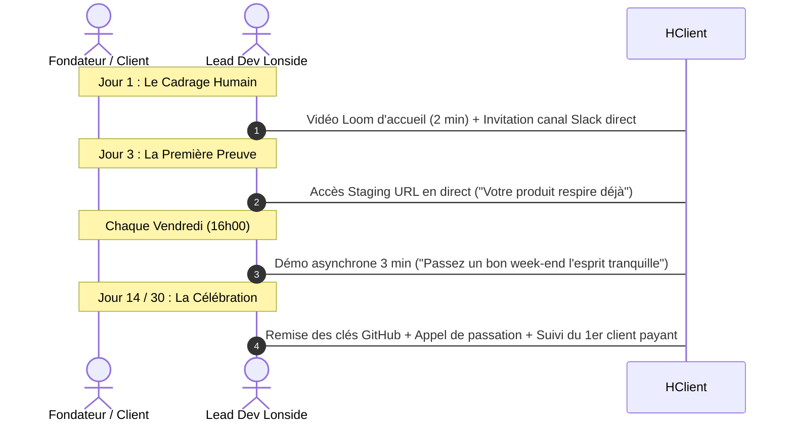

# 🎯 Lonside — Playbook Marketing & Charte de Communication

**Version :** 1.0  
**Statut :** Document de travail de référence  
**Dernière mise à jour :** Novembre 2026  
**Audience :** Fondateurs, Tech Leads, Équipe Marketing & Rédacteurs Lonside  

---

## 1. Philosophie Centrale : L'Artisanat Empathique

### 1.1 Le Diagnostic & La Rupture
L'écosystème tech souffre d'un excès de jargon défensif et d'une déshumanisation croissante. Les agences traditionnelles parlent comme des ordinateurs pour masquer leur lenteur ou justifier des devis opaques.

**La règle d'or de Lonside :**
> *« La véritable expertise ne se mesure pas au nombre d'acronymes qu'on utilise, mais à la clarté avec laquelle on résout un problème complexe et au respect qu'on porte à l'angoisse de celui qui paie. »*

Lonside se positionne comme **l'Anti-Agence par excellence** :
* Nous refusons la condescendance technique.
* Nous refusons les faux délais et les devis à tiroirs.
* Nous traitons chaque projet avec la même fierté d'artisan que s'il s'agissait de notre propre entreprise.

---

## 2. Le Modèle "Dual-Layer" (Double Niveau de Lecture)

Pour séduire à la fois le **fondateur / dirigeant business** (qui paie et cherche du soulagement) et le **CTO / lead dev** (qui valide et cherche de la rigueur), notre communication s'articule en deux couches superposées :

```
┌─────────────────────────────────────────────────────────────────────────────┐
│  COUCHE 1 : CLARTÉ HUMAINE & IMPACT BUSINESS (Visible par tous)             │
│  Vocabulaire : Vitesse, sérénité, chiffre d'affaires, zéro dépendance.      │
│  Objectif : Rassurer le CEO, lever la peur de l'arnaque, donner envie.      │
│                                                                             │
│               [ Démarrer un projet ]     [ ⚙️ Spécifications d'Architecture ]│
└──────────────────────────────────────────────────────┬──────────────────────┘
                                                       │ (Clic du CTO)
                                                       ▼
┌─────────────────────────────────────────────────────────────────────────────┐
│  COUCHE 2 : L'AUTORITÉ TECHNIQUE D'ÉLITE (Pour les ingénieurs & CTOs)       │
│  Vocabulaire : Typage strict Zod, RLS PostgreSQL, DDD, ZDR, Playwright.     │
│  Objectif : Prouver la séniorité, prouver l'absence totale de dette.        │
└─────────────────────────────────────────────────────────────────────────────┘
```

---

## 3. Matrice des Personas & Angles d'Attaque

### Persona A : Le Fondateur Non-Technique (Startups & Porteurs de Projets)
* **Sa hantise secrète :** Se faire arnaquer, dépenser ses économies dans un truc qui ne marche pas, se sentir méprisé techniquement.
* **Ce qu'il veut entendre :** *"Votre produit sera prêt le jour convenu, vos clients pourront payer, et vous êtes 100% propriétaire de tout."*
* **Angle d'accroche :** Vitesse de mise sur le marché, certitude budgétaire, accompagnement bienveillant.

### Persona B : Le CTO / Directeur Technique (Scaleups & Startups Post-Seed)
* **Sa hantise secrète :** Recevoir du code "spaghetti", hériter d'une dette technique qu'il devra réécrire la nuit, les failles de sécurité.
* **Ce qu'il veut entendre :** *"TypeScript strict de bout en bout, tests Playwright >80%, zéro secret exposé, conformité RGPD/ZDR et PRs propres sur votre Git."*
* **Angle d'accroche :** Rigueur architecturale, respect des standards de son équipe, vélocité commando sans concession.

### Persona C : Le Dirigeant de PME / E-commerçant (ex: clients type *Michi* ou *Welqo*)
* **Sa hantise secrète :** Être captif d'un CMS qui rame, dépendre d'un freelance qui ne répond plus, perdre des clients lors d'une refonte.
* **Ce qu'il veut entendre :** *"Une application stable qui ne plante jamais, 0 € d'abonnements superflus, et un outil qui fait gagner 15h par semaine à vos équipes."*
* **Angle d'accroche :** Fiabilité opérationnelle, ROI mesurable, souveraineté.

---

## 4. Dictionnaire de Dé-jargonisation (Lexique de Marque)

La règle interne pour toute rédaction de contenu (site, proposition commerciale, e-mail) :

| Terme Interne / Technique Froid | Traduction Humaine & Business (Niveau 1) | Justification Technique (Niveau 2 - Pour le CTO) |
| :--- | :--- | :--- |
| **Next.js 16 App Router & RSC** | *"Un site ultra-rapide qui s'affiche en moins d'une demi-seconde pour convertir vos visiteurs sans attente."* | Server Components, Zero-waterfall, routage optimisé, SEO hybride natif. |
| **Supabase PostgreSQL & RLS** | *"Une sécurité digne d'un coffre bancaire : les données de vos clients sont scellées et étanches."* | Row-Level Security stricte, isolation multi-tenant cryptographique, migrations SQL versionnées. |
| **TypeScript Strict & Zod** | *"Une fiabilité industrielle : le code vérifie chaque information pour éliminer les bugs avant même le lancement."* | Validation des schémas d'entrée au runtime, inférence statique stricte, contrats d'API typés. |
| **PostHog & Resend intégrés** | *"Dès le premier soir, vous savez qui utilise votre produit et vos e-mails de bienvenue partent automatiquement."* | Capture télémétrique native, funnels de conversion, webhooks idempotents, zéro cookie tiers intrusif. |
| **Cession 100% Git Privé** | *"Vous êtes chez vous. Zéro abonnement d'agence obligatoire, vous possédez chaque ligne de code."* | Dépôt privé client, licence patrimoniale complète transférée à chaque commit, zéro lock-in propriétaire. |
| **Ingénierie assistée par IA** | *"Nos ingénieurs éliminent les tâches répétitives pour consacrer 100% de leur matière grise à votre succès."* | Agents internes de scaffolding, documentation continue, tests automatisés avec clés certifiées ZDR. |

---

## 5. Le Manifeste Lonside (Texte de Marque Officiel)

Ce texte doit figurer sur la page d'accueil ou la page "À Propos" pour poser notre différence :

```markdown
> ### Pourquoi Lonside existe
>
> Nous avons vu trop d'entrepreneurs passionnés se faire brûler par des agences qui prennent 
> 6 mois pour livrer des solutions instables.
> 
> Nous avons vu trop de fondateurs dépenser leur énergie et leur capital dans des devis à rallonge, 
> pour se retrouver avec un code qu'ils ne possèdent pas et des interlocuteurs devenus injoignables.
> 
> Nous avons fondé Lonside avec une conviction simple :
> 
> 1. Vous méritez de parler directement à des ingénieurs qui s'intéressent à votre entreprise.
> 2. Vous méritez des budgets et des dates fermes, parce que votre temps et votre argent sont précieux.
> 3. Vous méritez du code écrit avec fierté, propre, documenté et qui vous appartient à 100%.
> 
> Pas de jargon pompeux. Pas de devis cachés. Juste des applications exceptionnelles livrées vite, 
> pour que votre vision devienne réalité.
```

---

## 6. Les Rituels de l'Expérience Client (L'Expérience "Haute Couture")

La satisfaction et la réputation de Lonside reposent sur 4 rituels relationnels obligatoires :



1. **Le Message d'Accueil Personnalisé (J1) :** Vidéo Loom du Lead Developer présentant l'espace de travail et son engagement personnel.
2. **La Preuve Immédiate (J3) :** Le client clique sur son URL Vercel privée et voit l'interface en ligne.
3. **Le Rituel du Vendredi "Zero Stress" :** Une note courte avec un résumé visuel des livrables de la semaine pour que le client passe un week-end serein.
4. **La Célébration du Premier Client Payant :** Un appel ou un message chaleureux dès la première transaction Stripe enregistrée.

---

## 7. Plan d'Implémentation sur le Site Web

* **Header & Hero :** Afficher l'accroche humaine principale + un bouton d'accès rapide aux *Spécifications Techniques*.
* **Composant Offres (`FlagshipOffers.tsx`) :**
  * Présenter **Sprint Launch (14j - 6 900 €)** et **Sprint Scale (30j - 13 900 €)** avec les bénéfices humains mis en avant (Sérénité, Délai ferme, Stack Growth incluse).
  * Ajouter sous chaque carte un accordéon cliquable : *« Voir l'architecture technique détaillée pour les ingénieurs »*.
* **Section Continuité (`/tarifs`) :**
  * Onglet dédié à la **Régie d'Immersion & Squad Dédiée** formulé autour de l'accompagnement d'équipe (*« Conservez le même Lead Dev dans votre squad sans coût de recrutement »*).
* **Section Preuves Techniques :**
  * Mettre en valeur les études de cas *Michi* et *Bely* avec deux niveaux de lecture : le problème business résolu (Niveau 1) et le schéma d'architecture basse latence (Niveau 2).

