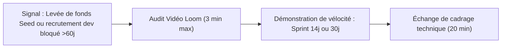
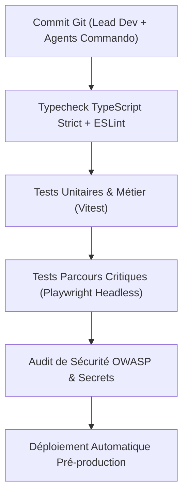

# ⚙️ Lonside — Playbook Opérationnel & Standard de Livraison

**Version :** 1.0  
**Statut :** Document de travail opérationnel de référence  
**Dernière mise à jour :** Novembre 2026  
**Audience :** Direction, Ingénieurs Seniors, Tech Leads & Business Developers Lonside  

---

## 1. Philosophie Opérationnelle : L'Ingénierie Sans Friction

Ce playbook définit les standards d'exécution de Lonside inspirés des studios d'ingénierie les plus avancés de la tech mondiale (*MetaLab, Thoughtbot, DevSquad, Basecamp*). 

Notre mot d'ordre opérationnel :
> *« Éliminer 90% de la bureaucratie des agences traditionnelles pour concentrer 100% de l'énergie sur la vélocité, la précision logicielle et la satisfaction client. »*

---

## 2. Prospection & Traitement des Appels d'Offres (RFP)

### 2.1 La Prospection Chirurgicale (Account-Based Marketing)
Lonside ne pratique aucun démarchage de masse générique. Notre acquisition outbound repose sur la détection de signaux faibles à haute valeur :



* **Le protocole de l'Audit Loom (3 minutes chrono) :**
  1. *Minute 1 (Le problème réel) :* Montrer l'application ou le site actuel du prospect, pointer un goulot d'étranglement concret (ex: lenteur Web Vitals, absence de tunnel Stripe optimisé, friction UX mobile).
  2. *Minute 2 (La solution d'architecture) :* Afficher un schéma de données ou un comparatif d'architecture résolvant le problème en Next.js 16 + Supabase.
  3. *Minute 3 (L'offre ferme) :* Présenter le Sprint Launch (14j) ou Scale (30j) comme alternative immédiate aux 4 mois de recrutement d'un CDI.

### 2.2 Le Protocole "Opinionated Proposal" face aux Appels d'Offres
Face à un cahier des charges public ou privé (RFP), Lonside refuse les grilles Excel de 200 questions et envoie une **Proposition d'Opinion en 3 pages** :

* **Page 1 : Recadrage Stratégique**  
  *« Vous demandez 15 fonctionnalités sur 6 mois. D'après les données de votre marché, 3 d'entre elles génèrent 80% des conversions. Voici pourquoi nous recommandons de scinder le projet en un Sprint Launch immédiat pour tester vos hypothèses en conditions réelles. »*
* **Page 2 : Architecture & Stack Infaillible**  
  Schéma d'infrastructure (Next.js 16, Supabase Postgres, RLS, Stripe, PostHog), engagement Zero Data Retention (ZDR) et garantie de cession totale sur Git.
* **Page 3 : Devis Ferme & Calendrier Garanti**  
  Montant fixe, date ferme de livraison, pénalité de retard contractuelle de 10% par tranche de 48h assumée par Lonside.

---

## 3. Le Parcours Client & Le Protocole d'Échange Asynchrone

Pour éradiquer la fatigue des réunions hebdomadaires stériles, Lonside standardise un parcours client fluide et asynchrone :

```
┌────────────────────────────────────────────────────────────────────────┐
│                   LE PARCOURS CLIENT LONSIDE EN 5 TEMPS                │
├────────────────────────────────────────────────────────────────────────┤
│ 1. [J-1] Le Command Center   : Page Notion/Linear partagée             │
│ 2. [J+1] Canal Slack Connect : Liaison directe sans chef de projet     │
│ 3. [J+3] Première Staging    : Déploiement Vercel actif et testable    │
│ 4. [Hebdo] Loom du Vendredi  : 3 minutes de démo visuelle à 16h00      │
│ 5. [J14/30] The Handover     : Remise des clés, célébration, garantie  │
└────────────────────────────────────────────────────────────────────────┘
```

### 3.1 L'Espace Client Unique : Le "Command Center"
Dès la signature, le client reçoit un lien sécurisé regroupant :
* Le compte à rebours officiel du sprint (avec clause de gel en cas d'attente d'un tiers).
* La matrice fermée des fonctionnalités (Statuts : *Backlog validé*, *En développement*, *En test QA*, *Validé sur Staging*).
* Le lien direct vers l'environnement de pré-production Vercel.
* Le coffre-fort d'échange de clés API sécurisé (Bitwarden / 1Password).

### 3.2 La Communication : "Slack Connect + Loom"
* Aucun échange d'instructions par e-mail ou sur messagerie personnelle.
* Tout retour complexe est formulé par vidéo Loom plutôt que par pavés textuels.
* L'approbation d'un livrable se fait par validation sur la Preview Branch Vercel.

---

## 4. Les Standards d'Ingénierie & La Pipeline de Qualité

Chaque produit conçu par Lonside respecte une discipline logicielle non négociable :



### 4.1 Le "Starter Kit Propriétaire" Lonside
Pour livrer un MVP en 14 ou 30 jours sans dette technique, 70% de l'infrastructure est pré-assemblée le Jour 1 :
* **Next.js 16 (App Router) :** React Server Components (RSC), Server Actions sécurisées, Zero-waterfall data fetching.
* **Supabase PostgreSQL :** Politiques Row-Level Security (RLS) cloisonnant hermétiquement les données entre organisations.
* **Stripe Engine :** Webhooks idempotents pré-câblés, gestion du Customer Portal et des échecs de paiement.
* **Growth Stack :** PostHog pour l'analytique et Resend pour les e-mails transactionnels déjà opérationnels.

### 4.2 Les Critères de Validation QA
Aucun sprint n'est livré sans le franchissement des métriques suivantes :
* **Score Google Lighthouse :** $\ge 95/100$ sur mobile et desktop.
* **Couverture de tests :** $\ge 80\%$ sur l'ensemble des parcours critiques (authentification, paiement, actions métier).
* **Zéro secret exposé :** Scan automatique bloquant tout déploiement en cas de fuite de clé API dans le code.

---

## 5. Le Pack de Livraison Officiel (The Handover Pack)

Le dernier jour du sprint, Lonside remet formellement au client son **Dossier de Propriété Industrielle** :

```
┌────────────────────────────────────────────────────────────────────────┐
│                        LE PACK HANDOVER LONSIDE                        │
├────────────────────────────────────────────────────────────────────────┤
│ ✔ Cession de Propriété Git    : Transfert d'administration GitHub      │
│ ✔ Walkthrough Loom (15 min)   : Visite guidée de l'architecture        │
│ ✔ Schéma Relationnel (ERD)    : Modélisation visuelle des données      │
│ ✔ Attestation de Qualité QA   : Rapport de tests Vitest & Playwright   │
│ ✔ Certificat de Garantie 24h  : Couverture 30 ou 45 jours incluse      │
│ ✔ Guide d'Onboarding Développeur : Prêt pour n'importe quel dev senior  │
└────────────────────────────────────────────────────────────────────────┘
```

* **Le Test des 120 Minutes :** Tout nouvel ingénieur intégrant l'équipe du client doit être capable d'exécuter `pnpm install && pnpm dev` et de pousser son premier commit documenté en moins de 2 heures.

---

## 6. La Transition vers la Continuité (L'Après-Sprint)

Dès le J+14 ou J+30, le client est accompagné vers le palier suivant sans rupture opérationnelle :

1. **Option Maintenance Sérénité (790 € à 1 290 € / mois) :**
   * Surveillance proactive des alertes Sentry et correctifs de sécurité sous 24h.
   * 1 journée d'ingénierie par mois incluse pour les ajustements d'usage.
2. **Option Régie d'Immersion (10j ou 20j / mois) :**
   * Le même Lead Developer Lonside reste membre de la squad du client sur Slack et Linear.
   * Zéro temps d'onboarding, flexibilité contractuelle mensuelle sans préavis lourd.
3. **Option Sprint d'Itération V2 (3 500 € / semaine) :**
   * Réactivation d'un commando pour livrer une extension de fonctionnalités validée par les premiers utilisateurs.

