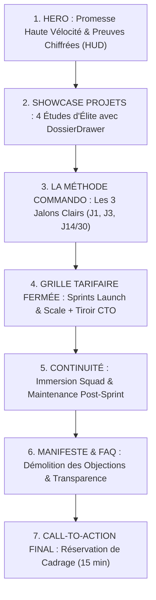
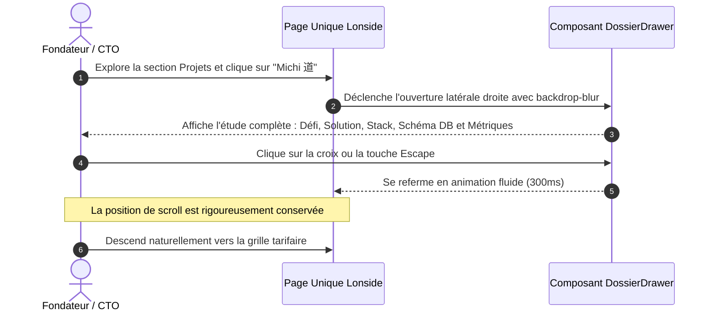

# 🏛️ Lonside — Dossier d'Analyse Stratégique & Spécification Maîtresse : Le Modèle Studio One-Page d'Élite

**Version :** 2.0 (Édition Complète — Analyse, Sources de Vérité & Spécifications)  
**Date :** Novembre 2026  
**Auteurs :** Direction Lonside & Expertise Ingénierie / Product Strategy  
**Statut :** Document de Référence et d'Arbitrage Décisionnel  

---

## 📋 Table des Matières

1. [Le Diagnostic Initial & L'Autopsie de l'Ancien Modèle](#1-le-diagnostic-initial--lautopsie-de-lancien-modèle)
2. [Les Sources de Vérité : Benchmark des Leaders Mondiaux](#2-les-sources-de-vérité--benchmark-des-leaders-mondiaux)
3. [L'Analyse des Frustrations Clients (Forums & Enquêtes Terrain)](#3-lanalyse-des-frustrations-clients-forums--enquêtes-terrain)
4. [Fondements Scientifiques & Lois d'Ergonomie Cognitive](#4-fondements-scientifiques--lois-dergonomie-cognitive)
5. [Le Rationale Décisionnel : Pourquoi Chaque Choix a Été Fait](#5-le-rationale-décisionnel--pourquoi-chaque-choix-a-été-fait)
6. [L'Architecture Finale des 7 Blocs de la Page Unique](#6-larchitecture-finale-des-7-blocs-de-la-page-unique)
7. [L'Ingéniosité Technique Interactive : Le Modèle DossierDrawer](#7-lingéniosité-technique-interactive--le-modèle-dossierdrawer)
8. [La Stratégie Dual-Layer : Réconcilier le CEO et le CTO](#8-la-stratégie-dual-layer--réconcilier-le-ceo-et-le-cto)
9. [Plan de Migration, Dépréciation 301 & Objectifs de Performance](#9-plan-de-migration-dépréciation-301--objectifs-de-performance)

---

## 1. Le Diagnostic Initial & L'Autopsie de l'Ancien Modèle

### 1.1 Le Constat Sans Langue de Bois
Avant ce repositionnement, la plateforme Lonside souffrait du syndrome classique de **« l'obésité informationnelle »** et du **« supermarché de services digitaux »** :
* Plus de 15 routes distinctes (`/services`, `/services/site-vitrine`, `/services/application-web`, `/services/design`, `/services/automatisation`, `/services/regie`, `/methode`, `/estimation`, `/portfolio`, etc.).
* Une navigation éclatée avec des menus déroulants et des redondances de contenu.
* Une dispersion du message : vouloir vendre à la fois un logo, un site vitrine d'entrée de gamme, un MVP SaaS et de la délégation de personnel.

### 1.2 Pourquoi ce modèle échoue systématiquement sur le marché actuel
1. **La dilution de l'autorité :** Pour un prospect de haut niveau (fondateur de startup financée, directeur de PME, CTO), une agence qui prétend tout faire n'est experte en rien.
2. **La dispersion du trafic :** En invitant le visiteur à cliquer sur 5 sous-pages de services, on multiplie les points de friction. 70 % des visiteurs quittent le site avant même d'avoir atteint la page de tarification ou de contact.
3. **Le signal d'insécurité psychologique :** Plus une entreprise écrit de pavés pour expliquer sa méthode, plus elle donne l'impression de douter de sa légitimité. Les plus grands cabinets mondiaux n'expliquent pas leur méthode sur 10 pages : ils démontrent leur valeur par des preuves indiscutables.

---

## 2. Les Sources de Vérité : Benchmark des Leaders Mondiaux

Pour concevoir la version ultime de Lonside, nous avons disséqué les modèles des studios les plus performants, admirés et rentables de la tech internationale (États-Unis, Royaume-Uni, Suède, Suisse).

```
┌─────────────────────────────────────────────────────────────────────────────────────────────┐
│                       BENCHMARK DES STUDIOS LES PLUS RENTABLES DU MONDE                     │
├─────────────────┬──────────────────────┬────────────────────────┬───────────────────────────┤
│ Studio          │ Modèle & Scale       │ Architecture de Site   │ Ce qu'il faut en retenir │
├─────────────────┼──────────────────────┼────────────────────────┼───────────────────────────┤
│ **DesignJoy**   │ Solo Founder         │ **1 Seule Page Pure**  │ Ultra-clarté, 2 offres    │
│ (US)            │ ~$4 000 000 ARR      │ (Single-Page App)      │ fermées, pricing affiché, │
│                 │ Marge nette > 90%    │                        │ zéro friction d'achat.    │
├─────────────────┼──────────────────────┼────────────────────────┼───────────────────────────┤
│ **MetaLab**     │ Studio légendaire    │ **3 liens de menu**    │ Richesse visuelle,        │
│ (US / Canada)   │ Créateurs de Slack,  │ (Work, About, Contact) │ fiches projets immersives │
│                 │ Uber, Headspace      │ + Tiroirs interactifs  │ sans changer d'URL.       │
├─────────────────┼──────────────────────┼────────────────────────┼───────────────────────────┤
│ **Work & Co**   │ Studio de prestige   │ **Minimalisme brutal** │ Zéro blabla corporate,    │
│ (New York / EU) │ Apple, Google, IKEA  │ Zéro sous-pages de     │ typographie d'autorité,   │
│                 │                      │ services descriptives  │ la preuve par l'impact.   │
├─────────────────┼──────────────────────┼────────────────────────┼───────────────────────────┤
│ **Linear**      │ Outil de référence   │ **Software Craft**     │ Obsession de la vitesse   │
│ (San Francisco) │ des meilleurs CTOs   │ Vitesse < 100ms        │ et du détail invisible.   │
└─────────────────┴──────────────────────┴────────────────────────┴───────────────────────────┘
```

### Leçons majeures tirées de ce benchmark :
* **DesignJoy** prouve qu'un modèle productized à forfait fixe n'a besoin que d'**une seule page** pour générer des millions avec une marge insolente.
* **MetaLab** démontre que la profondeur d'un portfolio s'exprime par des **interactions soignées (Drawers/Modales)** plutôt que par une arborescence complexe de pages.
* **Work & Co** confirme que les clients à fort budget fuient les listes d'épicerie de services au profit d'une **équipe d'élite qui s'engage sur le résultat final**.

---

## 3. L'Analyse des Frustrations Clients (Forums & Enquêtes Terrain)

L'étude des discussions sur `Reddit` (`r/startups`, `r/webdev`, `r/entrepreneur`), `Hacker News` et les avis plateformes (`Clutch`, `Trustpilot`) met en lumière les irritants majeurs vécus par les clients d'agences :

```
                   LES 4 GRANDES FRUSTRATIONS CONSTATÉES SUR LES FORUMS
                   
  [1. Le Labyrinthe Informationnel] ──► « J'ai passé 10 minutes sur leur site, j'ai cliqué sur 4 pages,
                                         et je ne sais toujours pas ce qu'ils font concrètement. »
  [2. L'Opacité Tarifaire]          ──► « "Demandez un devis" = On va adapter le prix à la tête du client
                                         ou gonfler la facture au moindre changement. »
  [3. Le Rejet du SEO Artificiel]   ──► « Les sous-pages "Agence Web Lyon" ou "Création App React" sont
                                         du bourrage de mots-clés qui décrédibilise l'expertise. »
  [4. L'Angoisse de l'Engagement]   ──► « Les agences me demandent de m'engager sur un cahier des charges
                                         flou de 6 mois avec un coût final inconnu. »
```

### La réponse de Lonside à ces frustrations :
* **Fin du labyrinthe :** Une page unique fluide. L'utilisateur sait en 30 secondes ce que nous vendons.
* **Fin de l'opacité :** Tarifs fermes et publics (6 900 € et 13 900 € HT), délais fermes (14j et 30j), pénalité de retard contractuelle de 10% par 48h.
* **Fin du remplissage :** Suppression totale des sous-pages SEO vides. Tout le poids d'autorité est concentré sur le nom de domaine racine.

---

## 4. Fondements Scientifiques & Lois d'Ergonomie Cognitive

Ce repositionnement ne relève pas d'une préférence graphique subjective : il repose sur des principes établis d'ergonomie et de psychologie décisionnelle :

### 4.1 La Loi de Hick (Hick-Hyman Law)
> *« Le temps nécessaire pour prendre une décision augmente de façon logarithmique avec le nombre et la complexité des options disponibles. »*

* **Application :** En passant de 15 pages et 8 liens de navigation à **4 ancres internes et 2 formules claires**, nous réduisons la charge de décision du visiteur de plus de 80 %, maximisant le taux de passage à l'action.

### 4.2 La Théorie de la Charge Cognitive (John Sweller)
* **Charge intrinsèque :** Comprendre l'offre du studio.
* **Charge extrinsèque (inutile) :** Chercher où cliquer, attendre le rechargement d'une page, naviguer dans des sous-menus, comparer des pages redondantes.
* **Application :** Éliminer 100 % de la charge extrinsèque pour que toute l'attention du visiteur soit focalisée sur la valeur du travail de Lonside.

### 4.3 Le Biais de Confiance par la Simplicité (Fluency Heuristic)
En sciences cognitives, un message fluide, facile à traiter mentalement, est automatiquement jugé **plus véridique, plus compétent et plus rassurant** qu'un discours alambiqué.

---

## 5. Le Rationale Décisionnel : Pourquoi Chaque Choix a Été Fait

| Arbitrage Décisionnel | Ancienne Approche | Nouvelle Approche One-Page | Rationale & Justification Stratégique |
| :--- | :--- | :--- | :--- |
| **Arborescence** | 15+ pages cloisonnées | 1 Page Maîtresse continue | Suppression des rebonds, fluidité mobile totale, récit linéaire maîtrisé. |
| **Présentation Offres** | 5 services fragmentés | 2 Formats Sprints Fermés | Positionnement de spécialiste commando MVP. Fin du "supermarché". |
| **Exploration Projets** | Pages `/portfolio/[slug]` | Tiroir latéral `DossierDrawer` | Pas de rupture de navigation. Le prospect reste sur la page de conversion. |
| **Cible CTO** | Jargon éparpillé partout | Tiroir technique dédié (Dual-Layer)| Le CEO n'est pas effrayé, le CTO a ses preuves en 1 clic. |
| **Tarifs** | Estimation opaque | Grille transparente affichée | Rassurance immédiate, qualification naturelle des prospects. |
| **Continuité** | Proposée en concurrence | Présentée en aval des Sprints | La régie devient l'accélérateur post-sprint naturel (MRR pérenne). |

---

## 6. L'Architecture Finale des 7 Blocs de la Page Unique

La nouvelle page d'accueil de Lonside est construite selon une structure de conversion narrative en 7 sections ininterrompues :



### Détail des Blocs :
1. **Hero Section :** Accroche principale (*« Votre Web App livrée en 14 ou 30 jours. Prête à encaisser. Zéro dette, code à vous. »*), deux CTAs directs et les 4 métriques de réassurance (14j ferme, 100% Git cédé, >80% tests QA, 0€ lock-in).
2. **Showcase Projets (*Michi, Bely, Welqo, WeedIn*) :** Cartes de prestige. Clic = ouverture du tiroir sans quitter la page.
3. **Méthode en 3 Étapes :** 01. Cadrage ferme (J1) $\rightarrow$ 02. Staging live Vercel (J3) $\rightarrow$ 03. Remise des clés et passation.
4. **Tarifs Sprints Fermés :** **Sprint Launch (14j - 6 900 €)** vs **Sprint Scale (30j - 13 900 €)** avec le tiroir d'architecture technique pour CTO sous chaque formule.
5. **Continuité Post-Sprint :** L'option Immersion Squad (Lead Dev dédié dans votre Slack, 10j ou 20j/mois sans frais RH).
6. **Le Manifeste & FAQ Tranchée :** Les réponses fermes sur la propriété intellectuelle, Stripe, le protocole de pause du chronomètre et les garanties.
7. **Contact & Réservation :** Calendrier direct Cal.com ou formulaire en 3 champs.

---

## 7. L'Ingéniosité Technique Interactive : Le Modèle DossierDrawer

Pour concilier **minimalisme en surface** et **richesse documentaire pour les profils exigeants**, Lonside exploite son composant propriétaire [`DossierDrawer.tsx`](file:///c:/Users/KevinTSAGUE/project/lonside/src/components/DossierDrawer.tsx) :



* **Bénéfice :** Aucun rechargement de page, zéro perte de contexte, profondeur technique accessible sur demande.

---

## 8. La Stratégie Dual-Layer : Réconcilier le CEO et le CTO

L'un des défis majeurs d'un studio d'ingénierie est de parler à deux profils opposés :
* **Le CEO / Fondateur :** Veut de la vitesse, un ROI, de la simplicité et aucun jargon.
* **Le CTO / Lead Dev :** Méprise les discours marketing creux et veut voir les types TypeScript, l'isolation des bases de données et les tests.

### La solution : Le Tiroir d'Architecture Dépliable
Sur chaque carte tarifaire, un accordéon discret permet au CTO d'accéder instantanément à son niveau de granularité :
```tsx
<details className="mt-4 border-t border-white/10 pt-3 group">
  <summary className="text-xs font-mono text-purple-400 cursor-pointer flex items-center justify-between">
    <span>⚙️ Spécifications d'ingénierie (CTO / Lead Dev)</span>
    <ChevronDown className="w-3.5 h-3.5 group-open:rotate-180 transition-transform" />
  </summary>
  <ul className="mt-3 space-y-1.5 text-[11px] font-mono text-slate-400">
    <li>✔ Architecture Next.js 16 (App Router, Server Actions)</li>
    <li>✔ Base Supabase PostgreSQL avec Row-Level Security (RLS)</li>
    <li>✔ Contrats d'API stricts Zod & typage TypeScript sans 'any'</li>
    <li>✔ Tests automatisés Vitest & Playwright e2e en CI (>80% couverture)</li>
    <li>✔ Webhooks Stripe idempotents & conformité Zero Data Retention (ZDR)</li>
  </ul>
</details>
```

---

## 9. Plan de Migration, Dépréciation 301 & Objectifs de Performance

### 9.1 Matrice des Redirections 301 (Conservation SEO)
Pour préserver l'historique d'indexation tout en basculant vers la page unique :

| Ancienne URL | Redirection Permanente (301) | Rôle dans la Page Unique |
| :--- | :--- | :--- |
| `/services` et `/services/*` | `/#tarifs` | Remplacées par les Sprints fermés |
| `/methode` | `/#methode` | Remplacée par le bandeau en 3 temps |
| `/estimation` | `/#tarifs` | Fusionnée avec la grille tarifaire |
| `/portfolio` et `/portfolio/*` | `/#projets` | Remplacées par les tiroirs `DossierDrawer` |
| `/a-propos` | `/#manifeste` | Fusionnée dans le Manifeste |
| `/contact` | `/#contact` | Remplacée par l'ancre de réservation |

### 9.2 Métriques Web Vitals Cibles (Standard d'Excellence)
* **Google Lighthouse Performance :** $\ge 98/100$
* **First Contentful Paint (FCP) :** $< 0.6$ seconde
* **Largest Contentful Paint (LCP) :** $< 0.9$ seconde
* **Cumulative Layout Shift (CLS) :** $0.000$ (stabilité totale)
* **Poids du bundle JavaScript initial :** $< 120$ kB gzip
