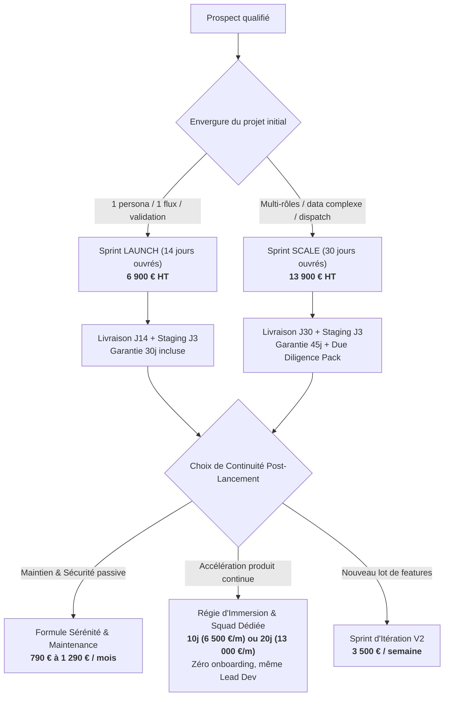

# 🧭 Lonside — Document de Suivi Stratégique & Positionnement

**Version :** 1.0  
**Statut :** En cours de déploiement  
**Dernière mise à jour :** Novembre 2026  
**Objectif :** Transition du modèle "Supermarché du digital" vers le modèle "Studio d'Ingénierie Digitale Haute Vélocité" (Formats Fermés Launch & Scale).

---

## 1. Vision & Identité de Marque

### 1.1 Le Constat Marché
* L'explosion du code assisté par IA (*Cursor, Claude Code, Lovable, v0*) rend les agences web généralistes obsolètes.
* Les clients fuient à la fois les agences lentes facturant des mois de TJM et les amateurs livrant du code IA non testé, non maintenable et plein de failles (*AI Slop*).
* La demande actuelle exige : **de la vitesse extrême**, **de la certitude budgétaire**, et **une rigueur d'ingénierie industrielle (code propre, testé et 100% cédé)**.

### 1.2 Le Positionnement Lonside
> **Lonside — Studio d'Ingénierie Digitale Haute Vélocité**  
> *Applications web et plateformes SaaS critiques livrées en délais fermes (14 ou 30 jours). Zéro dette technique, code 100% à vous, prêt à encaisser dès le jour du lancement.*

* **Moteur interne :** IA générative & agents commando exploités pour tripler la vitesse d'échafaudage.
* **Garantie externe :** Supervision constante par des ingénieurs seniors, architecture Domain-Driven Design (DDD), typage strict TypeScript et couverture de tests automatisés.

---

## 2. Grille des Deux Formats Fermés & Architecture en 3 Temps

Lonside structure sa valeur en 3 temps clairs : **Construire vite**, **Garantir**, puis **Accompagner la continuité** sans friction.



### 2.1 Spécifications Comparatives des Formats Sprints

| Dimension | Formule 01 : SPRINT LAUNCH | Formule 02 : SPRINT SCALE |
| :--- | :--- | :--- |
| **Délai ferme** | **14 jours ouvrés** | **30 jours ouvrés** (2 jalons de 15j) |
| **Tarif d'accès** | **6 900 € HT** (Acompte 50% / Solde 50%) | **13 900 € HT** (40% lancement / 30% J15 / 30% J30) |
| **Audience cible** | Solopreneurs, startups B2B, portails clients PME | Startups seed/series A, marketplaces, outils data |
| **Complexité rôles** | 1 rôle utilisateur principal + 1 admin minimal | Multi-rôles (Acheteur, Vendeur, Gestionnaire, Admin) |
| **Flux métier** | 1 flux central (ex: Upload $\rightarrow$ Calcul $\rightarrow$ Rendu) | Plusieurs flux interconnectés (Dispatch, matching, workflow) |
| **Intégrations API** | 1 connecteur clé (ex: Stripe ou webhook simple) | 2 à 4 connecteurs d'API (Stripe connect, CRM, ERP, IA) |
| **Base de données** | Schéma relationnel standard Supabase Postgres | Modélisation multi-tables complexe avec indexations fines |
| **Stack technique** | Next.js 16 + Tailwind v4 + Supabase + Stripe | Next.js 16 + Supabase + Redis + Stripe + Webhooks temps réel |
| **Garantie 0-Bug** | **30 jours** (correction prioritaire sous 24h) | **45 jours** (correction prioritaire sous 24h) |
| **Pack Inclus** | Stack Growth Day-1 + Code 100% Git cédé | Pack Growth + Pack Due Diligence Investisseur complet |

---

## 3. Les 5 Standards Différenciateurs (Inspirés des Studios US/Nordics)

### 3.1 Stack Growth "Day-1" (Inclus systématiquement)
Tout produit livré doit être opérationnel pour générer des revenus immédiatement :
* **PostHog pré-configuré :** Événements de conversion, entonnoirs et session replay.
* **E-mails transactionnels Resend :** Gabarits d'accueil et d'onboarding réactifs.
* **Stripe Customer Portal :** Facturation récurrente, gestion de carte et annulation en libre-service.

### 3.2 Pack "Due Diligence Investisseur" (Sprint Scale & option Launch)
Démontre une rigueur institutionnelle pour rassurer les fonds d'investissement et Business Angels :
* Schéma relationnel entité-association (ERD) documenté.
* Politiques de sécurité PostgreSQL RLS (Row-Level Security) auditées.
* Rapport de tests automatisés (Vitest + Playwright avec couverture > 80%).
* Zéro faille critique OWASP.

### 3.3 Environnement Staging Live dès J+3
* Déploiement continu Vercel sur une URL de pré-production dédiée.
* Canal Slack/Discord dédié avec notifications automatiques à chaque PR mergée.
* 1 vidéo Loom asynchrone par semaine pour remplacer les réunions chronophages.

### 3.4 Clause Contractuelle "Pause-Chrono"
Pour protéger Lonside des aléas externes sans pénaliser la vélocité :
* Le chronomètre (14j ou 30j) concerne exclusivement l'ingénierie active de Lonside.
* Tout blocage externe (délai de validation bancaire Stripe, attente de clés API client, validation DNS) gèle automatiquement le compteur.

### 3.5 Passation & Autonomie Totale
* Code 100% poussé sur le GitHub ou GitLab privé du client.
* Vidéo Loom de passation technique (walkthrough de l'architecture).
* Engagement : *"N'importe quel développeur senior Next.js recruté dans votre équipe est opérationnel sur le code en moins de 2 heures."*

---

## 4. Rôle et Affectation des Études de Cas Existantes

Les projets du portfolio existant servent d'ancres d'autorité technique pour justifier les deux formats :

```
┌────────────────────────────────────────────────────────────────────────┐
│                        PORTFOLIO STRATÉGIQUE                           │
├───────────────────────────────────┬────────────────────────────────────┤
│   Démonstrateurs SPRINT LAUNCH    │     Démonstrateurs SPRINT SCALE    │
│   (Simplicité, Conversion, Vitesse)│    (Haute complexité, Data, Concurrence)│
├───────────────────────────────────┼────────────────────────────────────┤
│ • Welqo (PropTech & Conciergerie) │ • Michi 道 (Supply Chain & Algorithmes)│
│ • WeedIn (EventTech & Billetterie)│ • Bely (Mobilité & Dispatch Temps Réel)│
└───────────────────────────────────┴────────────────────────────────────┘
```

---

## 5. Modèle Économique, Continuité & Régie Dédiée

Pour maximiser la Lifetime Value (LTV) sans forcer d'abonnement captif, Lonside déploie une continuité en 3 options claires une fois le MVP livré :

### 5.1 Option A : La Régie d'Immersion & Squad Dédiée (Le moteur de MRR)
Destinée aux startups financées et PME en forte traction qui veulent continuer à accélérer sans subir les délais et coûts d'un recrutement en CDI (3 à 6 mois de recrutement + 15k€ de chasseur de têtes).
* **Le principe :** Le Lead Developer ou la Squad Lonside qui a conçu et codé le MVP reste intégré directement dans les canaux de travail du client (Slack, Linear, GitHub).
* **Zéro temps d'onboarding :** Maîtrise parfaite immédiate de l'architecture, productivité instantanée.
* **Formules souples sans engagement rigide :**
  * **Temps Partiel (10 jours ouvrés / mois) :** ~6 500 € HT / mois.
  * **Plein Temps (20 jours ouvrés / mois) :** ~13 000 € HT / mois.
  * **Fractional CTO (1 à 2 jours / semaine) :** Pilotage technique stratégique, arbitrages de scalabilité et recrutement des futurs profils internes.

### 5.2 Option B : Le Forfait Sérénité & Maintenance (790 € à 1 290 € / mois)
Pour les plateformes stables nécessitant une veille passive et un SLA réactif :
* Surveillance des erreurs 24/7 via Sentry.
* Veille et montées de version des dépendances de sécurité (Next.js, Supabase, packages npm).
* 1 journée de développement senior incluse par mois pour ajustements mineurs.

### 5.3 Option C : Le Sprint d'Itération V2 (3 500 € / semaine)
Pour les clients autonomes qui souhaitent réactiver un commando ponctuel :
* Déblocage rapide d'un lot de 2 ou 3 fonctionnalités validées par les retours utilisateurs du premier mois.

---

## 5.4 Intégration sur le Site Web (Sans Brouiller le Message)

Pour ne pas cannibaliser le message d'appel des Sprints Fermés :
1. **Page d'accueil :** Le hero et 80% de la page restent focalisés sur la promesse de vélocité clé-en-main (**Sprint Launch 14j** et **Sprint Scale 30j**). Une section élégante en aval présente la promesse :  
   *« Et après le lancement ? Poursuivez l'aventure avec le même Lead Developer en immersion dans votre squad. »*
2. **Page Tarifs (`/tarifs`) :** Organisation en 2 onglets limpides :
   * **Onglet 1 (Par défaut) :** *Sprints Clé-en-Main (Launch 14j & Scale 30j)*.
   * **Onglet 2 :** *Continuité & Régie Dédiée (Pour squads et startups post-lancement)*.

---

## 6. Feuille de Route de Déploiement (Roadmap de Suivi)

### Phase 1 : Cadrage & Nettoyage du Site (Semaine 1)
- [ ] Supprimer les pages et références aux offres secondaires (Branding seul, petits sites vitrines basiques).
- [ ] Réécrire la page d'accueil (`src/app/[locale]/page.tsx`) avec la nouvelle promesse centrale.
- [ ] Mettre à jour `fr.json` et `en.json` pour aligner les messages sur les deux formats (Launch & Scale).

### Phase 2 : Refonte du Cadrage & Tarification (Semaine 2)
- [ ] Adapter le composant `FlagshipOffers.tsx` pour afficher le comparatif clair **Launch vs Scale**.
- [ ] Mettre à jour le simulateur `CostEstimator.tsx` pour guider l'utilisateur vers l'un des deux formats.
- [ ] Rédiger les fiches descriptives des livrables inclus (PostHog, Resend, RLS, Due Diligence Pack).

### Phase 3 : Outillage Opérationnel & Contractuel (Semaine 3)
- [ ] Rédiger le contrat type avec la clause de **Gel du Chronomètre (Pause Protocol)** et la définition stricte du périmètre.
- [ ] Finaliser le **Starter Kit d'Agence Lonside** (Next.js 16 + Supabase Auth + Stripe Billing + PostHog pré-câblés).
- [ ] Créer le template de documentation de passation client (Loom script + README standardisé).

### Phase 4 : Lancement & Acquisition (Semaine 4+)
- [ ] Rédiger 3 études de cas sous l'angle du problème business résolu et de la vélocité technique.
- [ ] Campagne de positionnement LinkedIn ciblant les fondateurs et CTOs en phase de cadrage MVP.
- [ ] Partenariats avec des incubateurs et réseaux d'accélérateurs.

---

## 7. Journal des Décisions Stratégiques (Changelog)

* **10 Novembre 2026 :** 
  * Décision d'abandonner l'offre "supermarché généraliste" pour adopter le modèle mono-spécialité à deux formats fermés (Option 2 : Sprint Launch 14j vs Sprint Scale 30j).
  * Intégration des standards d'excellence internationaux (Stack Growth Day-1, Due Diligence Pack, Pause Protocol).
  * Création du présent document de suivi.

