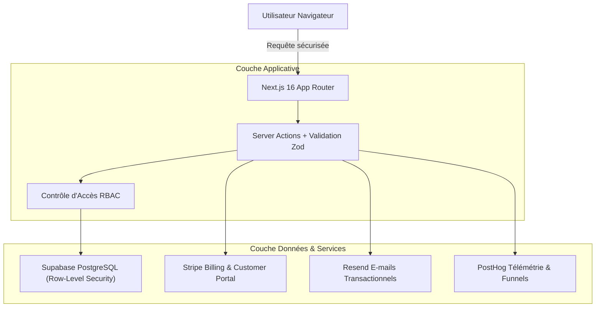

# 🏗️ Lonside — Spécification Technique : Le Starter Kit Propriétaire & L'Architecture d'Élite

**Version :** 1.0  
**Statut :** Spécification d'ingénierie de référence  
**Dernière mise à jour :** Novembre 2026  
**Audience :** Lead Developers, Ingénieurs Fullstack & Architectes Lonside  

---

## 1. Philosophie : L'Internal Platform Engineering

Les meilleurs studios de la Silicon Valley et d'Europe du Nord ne réinventent jamais la roue. Ils capitalisent sur un **Starter Kit Propriétaire** issu de centaines d'heures de R&D.

> **La règle des 30 minutes :**  
> Au Jour 1 d'un sprint, l'environnement complet (Auth multi-rôles, Base de données multi-tenant, Facturation Stripe, Tracking d'événements, CI/CD et Tests) doit être déployé et opérationnel en moins de 30 minutes. Les 13 jours et demi restants sont dédiés à 100% à la logique métier du client.

---

## 2. L'Arborescence Modulaire (Domain-Driven Design)

Le Starter Kit suit une architecture DDD allégée garantissant **zéro couplage circulaire** et une évolutivité immédiate :

```
/
├── .github/workflows/
│   ├── ci.yml                 # Lint, Typecheck, Tests Vitest & Playwright
│   └── security-scan.yml      # Détection de secrets et vulnérabilités OWASP
├── src/
│   ├── app/                   # Next.js 16 App Router (RSC & Server Actions)
│   │   ├── (auth)/            # Routes d'authentification (Login, Register, Reset)
│   │   ├── (dashboard)/       # Espace applicatif protégé (RBAC)
│   │   ├── (marketing)/       # Pages publiques & Vitrine haute conversion
│   │   ├── api/               # Webhooks sécurisés (Stripe, Resend)
│   │   ├── layout.tsx         # Root Layout optimisé (Font & Script sub-setting)
│   │   └── globals.css        # TailwindCSS v4 tokens
│   ├── domains/               # Cœur métier (DDD étanche)
│   │   ├── auth/              # Gestion des sessions, rôles et permissions
│   │   ├── billing/           # Plans Stripe, abonnements, portail client
│   │   ├── analytics/         # Capture PostHog & événements personnalisés
│   │   └── [business-core]/   # Domaine spécifique client (ex: supply, vtc)
│   │       ├── actions.ts     # Server Actions typées
│   │       ├── queries.ts     # Requêtes SQL / Supabase optimisées
│   │       ├── schemas.ts     # Schémas de validation Zod
│   │       └── types.ts       # Types TypeScript déduits
│   ├── components/            # UI Modulaire
│   │   ├── ui/                # Primitives accessibles (Radix UI / shadcn)
│   │   ├── layout/            # Navigation, Sidebar, UserMenu
│   │   └── feedback/          # Modales d'erreur, Toasts, Skeletons
│   ├── lib/
│   │   ├── supabase/          # Clients browser, server et admin (RLS)
│   │   ├── stripe/            # Initialisation SDK et handlers webhooks
│   │   ├── email/             # Templates React Email & client Resend
│   │   └── env.ts             # Validation stricte des variables d'environnement au build
│   └── tests/
│       ├── unit/              # Tests unitaires Vitest
│       └── e2e/               # Tests de bout en bout Playwright
```

---

## 3. Les Briques Fondamentales du Starter Kit



### 3.1 Authentification & Modèle Multi-Tenant (Supabase Auth & RLS)
* **Zero-Trust SQL :** Chaque table PostgreSQL possède la clause `ENABLE ROW LEVEL SECURITY`.
* **Politique d'isolation stricte (RLS) :**
  ```sql
  -- Exemple de politique étanche pour organisation multi-tenant
  CREATE POLICY "organization_isolation_policy" ON "public"."documents"
  FOR ALL
  USING (
    organization_id IN (
      SELECT org_id FROM "public"."organization_members"
      WHERE user_id = auth.uid()
    )
  );
  ```
* **Rôles natifs supportés :** `SUPER_ADMIN`, `ORG_OWNER`, `MEMBER`, `GUEST`.

### 3.2 Moteur de Facturation Stripe (Idempotent & Résilient)
* **Webhooks Idempotents :** Chaque événement Stripe (`checkout.session.completed`, `customer.subscription.updated`) est tracé dans une table PostgreSQL `stripe_events` avec contrainte d'unicité `event_id` pour éliminer tout risque de double exécution en cas de retry réseau.
* **Synchronisation bidirectionnelle :** Statut d'abonnement immédiatement répercuté dans la session utilisateur sans appel d'API bloquant.

### 3.3 Typage Strict & Contrats Zod
* Aucune variable d'environnement ou payload d'API n'est accepté sans validation préalable :
  ```typescript
  import { z } from 'zod';

  export const envSchema = z.object({
    NEXT_PUBLIC_SUPABASE_URL: z.string().url(),
    NEXT_PUBLIC_SUPABASE_ANON_KEY: z.string().min(20),
    STRIPE_SECRET_KEY: z.string().startsWith('sk_'),
    STRIPE_WEBHOOK_SECRET: z.string().startsWith('whsec_'),
  });
  ```

---

## 4. Pipeline d'Assurance Qualité & Sécurité (CI/CD)

Chaque commit exécuté par l'équipe Lonside déclenche la chaîne d'intégration continue GitHub Actions :

1. **Step 1 : Linting & Type-Checking**  
   `pnpm tsc --noEmit && pnpm eslint` (Zéro avertissement toléré).
2. **Step 2 : Tests Unitaires Métier (Vitest)**  
   Validation mathématique des algorithmes de calcul en moins de 3 secondes.
3. **Step 3 : Tests End-to-End Headless (Playwright)**  
   Simulation automatisée des 3 flux critiques :
   * Flux A : Inscription $\rightarrow$ Réception de l'email de confirmation $\rightarrow$ Connexion.
   * Flux B : Sélection d'un abonnement $\rightarrow$ Paiement Stripe Mock $\rightarrow$ Déverrouillage des droits.
   * Flux C : Action métier principale $\rightarrow$ Sauvegarde en base $\rightarrow$ Export.
4. **Step 4 : Audit de Sécurité Automatique**  
   Détection de secrets (TruffleHog / GitGuardian) et vérification des dépendances vulnérables (`pnpm audit`).

---

## 5. Performance Web & Standards Web Vitals

Pour garantir un score Google Lighthouse supérieur à **95/100** :
* **Zero Layout Shift (CLS < 0.05) :** Tailles des polices et des images strictement réservées via `next/font` et `next/image`.
* **Affichage Instantané (LCP < 1.2s) :** Pré-rendu statique des pages publiques et hydratation partielle des composants interactifs uniquement.
* **Interactivité Immédiate (INP < 100ms) :** Exécution différée des scripts de télémétrie tiers.

